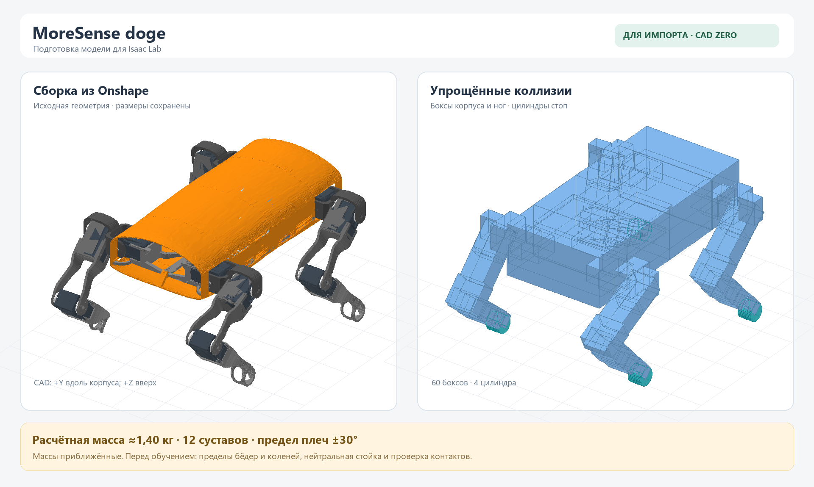

# MoreSense doge

MoreSense doge — проект четырёхногого домашнего робота-компаньона. В репозитории собраны CAD/URDF, калибровка 12 суставов, сохранённая политика ходьбы V1 и четыре запускаемых демонстрации управления.



Это **реконструкция разработки**, а не исходная история Git. В архиве сохранены результаты стойки и V1 в Newton. Новые демонстрации выводят углы в JSONL: они не запускают физику и не управляют роботом. Голос, камера и напоминания остаются целями [проектного предложения](docs/proposal.md).

## Ветки управления

| Как рассчитываются движения | Кто задаёт движение | Ветка | Запуск |
| --- | --- | --- | --- |
| Кинематическая рысь без RL | Оператор | `control/classic-manual` | [`classic-manual`](docs/modes/classic-manual.md) |
| Кинематическая рысь без RL | Маршрут и передний датчик | `control/classic-autonomous` | [`classic-autonomous`](docs/modes/classic-autonomous.md) |
| Сохранённая нейросеть V1 | Оператор | `control/rl-manual` | [`rl-manual`](docs/modes/rl-manual.md) |
| Сохранённая нейросеть V1 | Маршрут и передний датчик | `control/rl-autonomous` | [`rl-autonomous`](docs/modes/rl-autonomous.md) |

В `main` доступны все четыре режима. Ветки `control/classic` и `control/rl` содержат общие контроллеры двух семейств. `research/rl-v2` — отдельный эксперимент, не обученная модель и не замена V1.

## Быстрый запуск

Клонируйте репозиторий после входа в GitHub. Имя локальной папки `moresense_doge` также подходит для скриптов Isaac Lab. Для классических режимов нужен Python 3.10+:

```sh
git clone -c core.autocrlf=false https://github.com/abrapture/moresense-doge.git moresense_doge
cd moresense_doge
python3 -m doge_control classic-manual --ticks 40
python3 -m doge_control classic-autonomous --ticks 24
```

Для RL установите [PyTorch](https://docs.pytorch.org/get-started/locally/) в отдельное окружение. CPU-инференс проверен на Python 3.13 и PyTorch 2.11.0:

```sh
python3.13 -m venv .venv
source .venv/bin/activate
python -m pip install torch==2.11.0 numpy
python -m doge_control rl-manual --ticks 40
python -m doge_control rl-autonomous --ticks 24
python -m unittest discover -s tests
python -m unittest discover -s training/tests
```

Одна строка результата — отсчёт каждые 20 мс модельного времени: заданная скорость `command_vy_mps`, причина выбора и 12 целей `joint_targets_rad`. Операторские команды и показания дальности можно заменить своим JSONL. В ручном примере видны тайм-аут и `stop`; в автономном — остановка при препятствии на отсчёте 16.

## Что читать дальше

- [Хронология разработки и проверок](docs/development.md)
- [CAD, калибровка и стойка](docs/simulation.md)
- [Электроника, полудуплекс и 74LVC125APW](docs/hardware.md)
- [Как обучали V1 и почему её ещё рано переносить на робот](docs/rl-v1.md)
- [Источники и границы реконструкции](docs/provenance.md)
